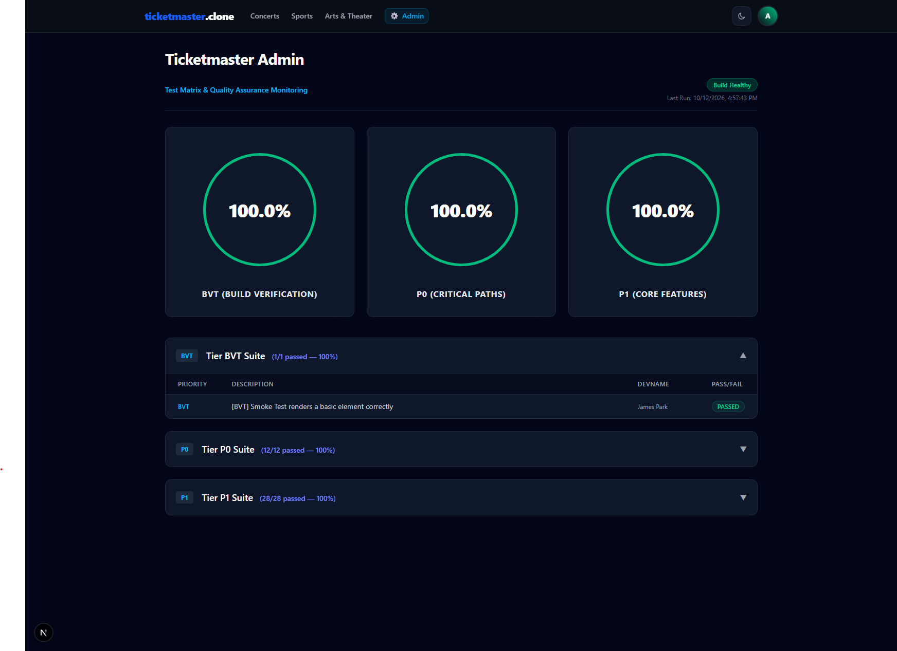

### [Ticketmaster Clone]

A full-stack event discovery and ticketing platform inspired by Ticketmaster, built with Next.js App Router, Tailwind CSS, Firebase, and the Ticketmaster Discovery API.

### [Key Features]

- Event Discovery & Search: Real-time event search powered by the Ticketmaster Discovery API with robust keyword and location-based filtering.
- Dynamic Event Details: Immersive event pages featuring date/time formatting, venue details, interactive order summaries, and deterministic pricing fallbacks.
- Secure Authentication: User sign-in and session management powered by Firebase Authentication.
- Seamless Checkout: End-to-end payment processing integrated with Stripe Checkout.
- Responsive Architecture: Built mobile-first with a modern, high-converting two-column layout styled using Tailwind CSS.

### [Tech Stack]

- Frontend & Framework: Next.js (App Router), React, Tailwind CSS
- APIs & Services: Ticketmaster Discovery API, Stripe API
- Backend & Auth: Firebase Auth & Firestore
- Deployment: Vercel

### [Project Structure]

public/
└── reports/
└── test-results/ # Vitest JSON test execution outputs for the Admin Dashboard
src/
├── **tests**/ # Integration & end-to-end test suites (auth-gate, booking, search)
├── app/ # Next.js App Router (pages and API endpoints)
│ ├── admin/ # Tiered test reporting & quality monitoring dashboard
│ ├── api/ # Backend API routes (Stripe checkout, Event handlers)
│ ├── checkout/success/ # Order success & confirmation page
│ ├── events/ # Dynamic event detail & multi-step checkout pages
│ ├── profile/ # User account & profile management
│ ├── search/ # Event discovery & keyword search filters
│ ├── tickets/ # User ticket view & management
│ ├── globals.css # Global Tailwind styles
│ ├── layout.tsx # Root layout with global styling & providers
│ └── page.tsx # Home / landing page
├── components/ # Reusable UI components & corresponding unit tests (.test.tsx)
├── context/ # React Context providers (Auth, Theme management)
├── lib/ # External service configuration & utilities (Firebase, userService)
└── test/ # Test environment setup & global mocks

### 🛡️ Admin Dashboard & Quality Monitoring

The application features a secure, role-based Admin Dashboard (`/admin`) that parses live Vitest JSON test execution artifacts (`public/reports/test-results/latest.json`) to monitor build and test health in real time.

  

#### **Demo Admin Access**

To explore the admin features locally or in production, you can sign in using the pre-configured admin account:

- **Email**: `admin@tmclone.com`
- **Password**: `admin@tampa.FL`
- **Security**: Enforces strict Firestore role verification (`users/{uid}` with `role: "admin"`), automatically redirecting unauthorized users.
